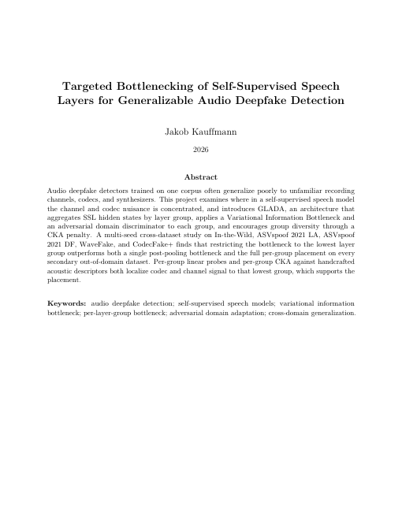

# GLADA: Grouped Layer Adversarial Domain Adaptation for Audio Deepfake Detection

GLADA is a research codebase for cross-domain audio deepfake detection. It was
built to test one question: **where inside a self-supervised speech model
should an information bottleneck go so that a deepfake detector trained on one
dataset still works on audio from somewhere else?**

This code produced the results in:

- **J. Kauffmann, F. Abri, and J. Webb**, *Per-Layer-Group Bottlenecking for
  Cross-Domain Audio Deepfake Detection*, accepted to IEEE ICTAI 2026.
- **J. Kauffmann**, *Targeted Bottlenecking of Self-Supervised Speech Layers for
  Generalizable Audio Deepfake Detection*, MS thesis, San José State
  University, 2026. Advisor: Dr. Faranak Abri. Committee: Dr. Amith Kamath
  Belman, Dr. Saptarshi Sengupta.

## Paper and thesis

<a href="docs/kauffmann_2026_ms_thesis.pdf"></a>

- **Thesis full text:** [docs/kauffmann_2026_ms_thesis.pdf](docs/kauffmann_2026_ms_thesis.pdf)
  (134 pages). ScholarWorks record: https://doi.org/10.31979/etd.kmc6-t6vf
  (the ScholarWorks download opens in May 2027). This copy matches the filed
  thesis except for one sentence removed from the acknowledgments.
- **ICTAI 2026 paper:** accepted to IEEE ICTAI 2026. The DOI and the author's
  accepted manuscript will be added here once the proceedings DOI is available.

<br clear="right">

## Try it

[](https://colab.research.google.com/github/JakobKauffmann/GLADA/blob/main/notebooks/00_demo/glada_demo.ipynb)

[`notebooks/00_demo/glada_demo.ipynb`](notebooks/00_demo/glada_demo.ipynb)
downloads a trained detector and labels audio as real or deepfake with
percentages: a real LibriSpeech recording, a text-to-speech clip, and any file
you upload.

**Released weights** (GitHub release
[`v1.0-weights`](https://github.com/JakobKauffmann/GLADA/releases/tag/v1.0-weights)):
per-group VIB on the lowest layer group, WavLM-Base-Plus, seed 42
(`model.safetensors` and `config.json`, about 470 MB). The release page has the
model card, including how the checkpoint was selected and its limits.

## Why GLADA

Deepfake detectors trained on controlled benchmarks often fail on real-world
audio. End-to-end systems below 1% Equal Error Rate (EER) on ASVspoof 2019
Logical Access reach 31 to 38% EER on the In-the-Wild (ITW) dataset. Recent
work narrows that gap by combining self-supervised (SSL) speech features,
adversarial domain adaptation, and a Variational Information Bottleneck (VIB).
However, the bottleneck is applied once, after all layers are pooled, even
though SSL layers carry domain-shift information (channel, codec, recording
conditions) differently at different depths.

GLADA tests whether placing the bottleneck at the layer group that carries the
strongest domain signal generalizes better than one global bottleneck. It
splits the SSL layers into groups and, for each group, puts a VIB and an
adversarial domain discriminator on the same gradient path. The bottleneck can
then be switched on or off per group to see where it matters.

## How it works

```
Raw audio (16 kHz, 4 s)
  -> RawBoost (training only)
  -> SSL backbone (WavLM, XLS-R, Data2Vec, Wav2Vec2; unfrozen in phase 2)
  -> per-layer LayerNorm
  -> layer groups g_1..g_K, attentive statistics pooling per group
  -> VIB per group (or a single post-pool VIB for comparison)
  -> spoof classifier
     + per-group domain discriminators (gradient reversal)
     + speaker adversary (gradient reversal)
```

Training objective:

```
L = L_spoof + α·L_GLADA + β·L_KL + γ·L_speaker + δ·L_CKA
```

`L_GLADA` is the per-group domain-adversarial loss, `L_KL` the VIB term, and
`L_CKA` a penalty that keeps the groups' representations diverse. Training
uses ASVspoof 2019 LA as the labelled source domain and ITW as an unlabelled
target domain.

The headline runs used α = 0.1, β = 0.01, γ = 0.1, δ = 0.01 (the
`GLADAConfig` defaults), 3 frozen-backbone epochs then 17 fine-tuning epochs,
batch 64 per domain with an effective batch of 384, backbone LR 5e-6 with
layer-wise decay 0.9, and RawBoost. Every run's exact settings are in its
`config.json`.

## Results

All headline numbers are on WavLM-Base-Plus (12 layers, K = 3 groups),
trained on ASVspoof 2019 LA only, over seeds 42, 123, and 456. EER (%),
mean ± std; lower is better.

**Where the bottleneck goes.** Per-group placement beats a single post-pool
bottleneck on ITW by 2.69 points and also lowers the seed variance.

| Bottleneck placement | s42 | s123 | s456 | Mean ± std |
|---|---|---|---|---|
| Single post-pool VIB | 14.28 | 16.52 | 13.17 | 14.66 ± 1.71 |
| Per-group VIB (all groups) | 11.67 | 13.40 | 10.83 | **11.97 ± 1.31** |
| Per-group VIB, lowest group only (g0) | 13.02 | 13.93 | 13.30 | 13.42 ± 0.47 |
| Per-group VIB, all but g0 | 17.61 | 14.46 | 14.61 | 15.56 ± 1.78 |

**Which group matters.** In a single-seed leave-one-out sweep, making a
group's bottleneck deterministic raises ITW EER by +5.94 points for g0, +2.13
for g1, and +0.32 for g2. The benefit concentrates in the lowest layer group.

**Generalization to held-out datasets.** Bottlenecking only g0 gives the lowest
mean EER on all four held-out benchmarks, even though full per-group placement
wins on ITW.

| Bottleneck placement | ITW | ASVspoof 2021 LA | ASVspoof 2021 DF | WaveFake | CodecFake+ |
|---|---|---|---|---|---|
| Single post-pool VIB | 14.66 ± 1.71 | 28.69 ± 0.65 | 44.04 ± 0.01 | 21.36 ± 2.10 | 38.65 ± 1.02 |
| Per-group VIB (all groups) | **11.97 ± 1.31** | 31.18 ± 2.09 | 43.97 ± 0.12 | 23.12 ± 3.81 | 37.49 ± 2.78 |
| Per-group VIB, g0 only | 13.42 ± 0.47 | **27.94 ± 0.65** | **43.89 ± 0.12** | **19.98 ± 2.94** | **36.46 ± 2.48** |
| Per-group VIB, all but g0 | 15.56 ± 1.78 | 29.67 ± 1.19 | 43.93 ± 0.15 | 22.61 ± 1.77 | 36.90 ± 1.59 |

**Supporting checks** (single seed, s42; directional only):

- *β sensitivity:* g0-only with β halved (0.005) reached 10.73% ITW EER.
- *Other backbones:* g0-only reached 12.95% ITW EER on WavLM-Large and 18.40%
  on XLS-R 300M.
- *Linear probes:* on the post-bottleneck representations of the best
  per-group checkpoint, codec accuracy drops with depth (0.857, 0.774, 0.563
  for g0, g1, g2) while spoof information is preserved in every group.

## Repository layout

Every folder has a README describing each file in it.

| Path | Contents |
|---|---|
| [`glada/`](glada) | The Python package: models, training, datasets, augmentation, evaluation, analysis. |
| [`notebooks/`](notebooks) | Colab notebooks in six numbered phases. Each phase README says what every notebook did and what it found. |
| [`experiment_results/`](experiment_results) | `config.json` and `history.json` for every run, in the same numbered phases, plus aggregated result files. Each README links runs back to their notebook. |
| [`reference/`](reference) | Earlier CS 297 prototypes (DANN, CORAL, MMD, and the hierarchical predecessor of GLADA). |
| [`DATASETS.md`](DATASETS.md) | Dataset downloads and the expected directory layout. |
| [`docs/`](docs) | The MS thesis PDF. |

Raw audio is not included. One trained checkpoint is published as a GitHub release (see Try it).

| Phase | Question |
|---|---|
| `00_demo` | Colab demo: load the released detector and label clips as real or deepfake. |
| `01_baseline_glada` | Does the full GLADA stack train end-to-end on WavLM-Large? |
| `02_ablation_multibackbone` | Which components and backbones help, on six datasets? (Full GLADA turned out worse on ITW than every single-component removal.) |
| `03_phase2_diagnosis` | Why does ITW get worse after the backbone unfreezes? (Led to per-group VIB.) |
| `04_pgvib_development` | Which group's bottleneck matters, over three seeds? |
| `05_cross_dataset_eval` | Do the results hold on four held-out datasets? |
| `06_analysis_and_figures` | What does each layer group encode; thesis figures. |

## Setup

Python 3.10 or 3.11 and a CUDA GPU. The thesis runs used Colab A100s.
WavLM-Base-Plus also fits on a 16 GB T4.

```bash
pip install -e glada/
```

Every notebook starts with a setup cell that mounts Google Drive, copies the
package to local disk, and extracts the datasets to `/content/data/`. Edit the
path constants in that cell (`DRIVE_PKG`, `ASV_AUDIO`, `ITW_AUDIO`, and so on)
to match your environment. Download links and the expected layout are in
[`DATASETS.md`](DATASETS.md).

A few settings matter:

- Audio is read with `soundfile.read()`. `torchaudio.load()` and
  `torchaudio.set_audio_backend()` are not used.
- DataLoaders use `num_workers=0`. Higher values caused worker crashes on Colab.
- `torch.compile()` is not used because it breaks WavLM's dynamic masking.
- Keep `domain_loss_weight` at 0.1 or lower. 0.5 destabilized training.

## Reproducing the main results

Only ASVspoof 2019 LA and In-the-Wild (about 13 GB) are needed for training.

1. **Per-group and g0-only VIB.** Run the notebooks in
   `notebooks/04_pgvib_development/`:
   - `phase_pgvib_monolithic.ipynb` for the single post-pool VIB
   - `phase_pgvib_g0only.ipynb` for g0-only (`PerGroupVIBModel` with
     `vib_disabled_groups=(1, 2)`)
   - `phase_pgvib_replicate.ipynb` for per-group and all-but-g0 seeds 123
     and 456 (seed 42 of per-group VIB comes from
     `03_phase2_diagnosis/phase_vib_stagger.ipynb`)
   - `phase_a_leaveout.ipynb` for the single-seed leave-one-group-out ablation
2. **Cross-dataset evaluation.** Run `cross_dataset_eval_pgvib_part_a.ipynb`
   (ASVspoof 2021 LA/DF), `cross_dataset_eval_pgvib_part_b.ipynb`
   (WaveFake, CodecFake+), then `cross_dataset_eval_pgvib_aggregate.ipynb` in
   `notebooks/05_cross_dataset_eval/`.

3. **Supporting checks.** The β probe runs are under
   `phase_pgvib_monolithic/g0_only_beta_*`, the WavLM-Large and XLS-R runs
   under `phase_pgvib_g0only/g0_only_large_s42` and
   `phase_pgvib_replicate/g0_only_xlsr_s42`, and the linear probes are in
   `notebooks/06_analysis_and_figures/glada_acoustic_analysis.ipynb`.

The exact configuration and per-epoch history of each run are in the
matching `experiment_results/04_pgvib_development/` folder.

## Citation

```bibtex
@inproceedings{kauffmann2026perlayergroup,
  author    = {Kauffmann, Jakob and Abri, Faranak and Webb, Jade},
  title     = {Per-Layer-Group Bottlenecking for Cross-Domain Audio Deepfake Detection},
  booktitle = {Proceedings of the IEEE International Conference on Tools with Artificial Intelligence (ICTAI)},
  year      = {2026}
}

@mastersthesis{kauffmann2026glada,
  author = {Kauffmann, Jakob},
  title  = {Targeted Bottlenecking of Self-Supervised Speech Layers for Generalizable Audio Deepfake Detection},
  school = {San Jos\'e State University},
  year   = {2026}
}
```

## License

The code is released under the [MIT License](LICENSE). The thesis PDF is
copyright Jakob Kauffmann and is shared for reading and citation. Datasets are
not redistributed here; see [`DATASETS.md`](DATASETS.md) for where to get them.
